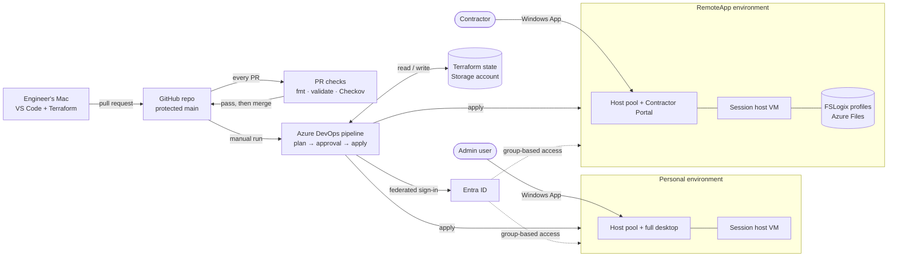
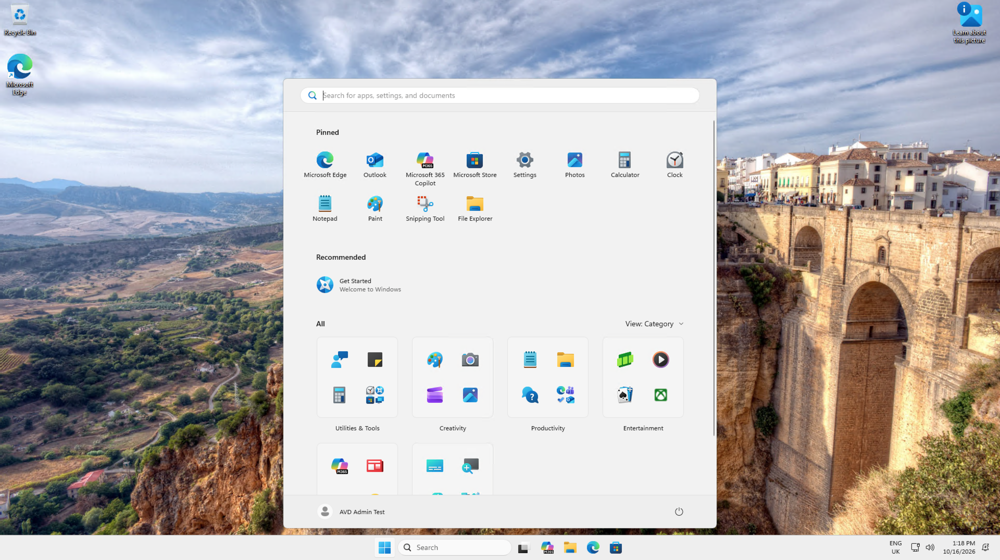
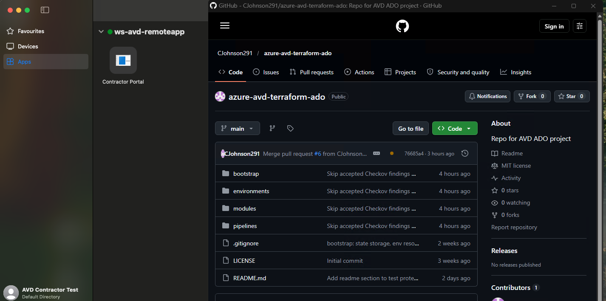
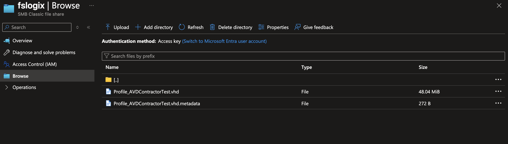
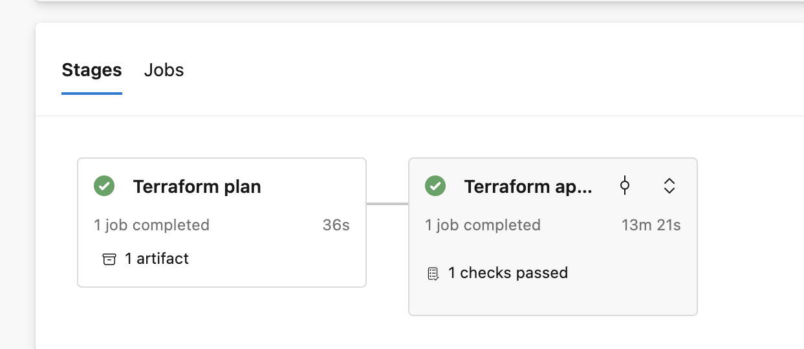
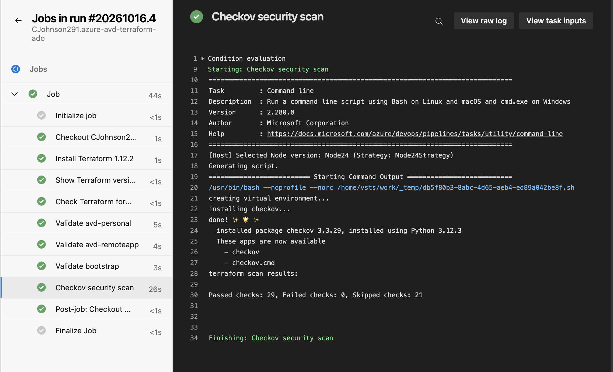
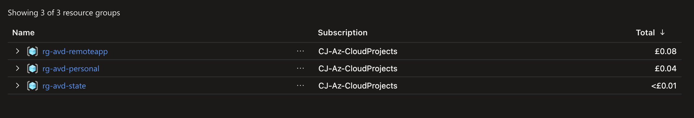

# Azure Virtual Desktop: Two Business Needs, Built with Terraform and Azure DevOps

Two Azure Virtual Desktop (AVD) environments: one gives admin users a full desktop, the other gives contractors a single published application. Both are provisioned by Terraform. The code lives in GitHub, with automated checks on every pull request and an approval gate before Azure DevOps applies any change.

**Stack:** Azure Virtual Desktop · Azure Files · FSLogix · Entra ID · Terraform · GitHub · Azure DevOps · Checkov

## What this demonstrates

- **Provisioned** two Azure Virtual Desktop environments with reusable Terraform modules and remote state
- **Automated** deployments through Azure DevOps: every change is planned, approved by a person, then applied exactly as approved
- **Gated** every pull request with Terraform format, validation and Checkov security checks; `main` is protected and accepts changes only through a passing PR
- **Eliminated** stored secrets: the pipeline signs in to Azure with workload identity federation, using short-lived tokens instead of passwords or keys
- **Tested** with real users: FSLogix roams user profiles via Azure Files, so they survive session hosts being rebuilt

## Architecture



 state = plan READS state (what exists), apply WRITES state (what now exists). -->

## Proof it works

**Personal desktop:** an admin test user signed in to a full Windows 11 desktop on a session host built by the pipeline.



**RemoteApp:** the contractor test user sees only one app, the Contractor Portal, which opens Edge straight to its site.



**FSLogix:** the contractor's profile is stored on Azure Files, not on the VM, so it survives the session host being rebuilt.



## The two environments

| | **Personal** | **RemoteApp** |
|---|---|---|
| **Who it's for** | Admins | Contractors |
| **What they get** | A full Windows desktop | One published app: Edge, opening the Contractor Portal |
| **Host pool type** | Personal: each admin gets their own dedicated VM | Pooled: users share hosts |
| **Load balancing** | Not applicable, same VM every time | Depth-first: fill one host before the next |
| **User profiles** | Local, because the VM is theirs | FSLogix on Azure Files, so the profile follows the user to any host |
| **Access** | An Entra ID admins group | An Entra ID contractors group |
| **Why this design** | An isolated, full desktop for privileged admin work | Only what the business need requires, which minimises what a contractor can reach |

## How deployment works

1. A Terraform change is made on a branch
2. A pull request is opened on GitHub
3. The PR checks run automatically: format, validate and Checkov. Any failure blocks the merge.
4. The PR is merged into the protected `main` branch (a person)
5. The deploy pipeline is started manually in Azure DevOps, choosing whether to deploy session hosts
6. **Plan stage:** Terraform creates a plan and saves it as a pipeline artifact
7. **Approval:** the run pauses until a person reviews the plan and approves it, within 1 day
8. **Apply stage:** Terraform applies that exact saved plan, nothing more

Setting session hosts to `false` and running again removes the VMs: the same pipeline builds and tears down.



## Security decisions

| Decision | Why it matters |
|---|---|
| No stored secrets: the pipeline signs in with workload identity federation | There's no password or key that could be stolen or leaked |
| Pipeline limited to the project's resource groups, and can grant only 3 specific roles | Reduces the blast radius if the pipeline is ever misused, and it can't grant itself or anyone else extra access |
| `main` is protected: PR only, required check, no bypass | Every change that can reach Azure is checked and recorded, including the owner's |
| PR checks have no Azure access | Untrusted PR code can't reach credentials or state |
| Approval is set on the Azure DevOps Environment, not in the YAML | A malicious or careless YAML edit can't remove the approval step |
| Checkov blocks insecure Terraform; accepted risks are skipped inline with a written reason | New risks are stopped at the PR, and accepted ones are documented next to the code |
| Terraform state is accessed with Entra ID and RBAC, not storage keys | State contains secrets; each identity's access is individually granted, auditable and revocable, with no master key to leak |



## Cost

The entire build and test cost **under £0.15** (Azure Cost Management, all three project resource groups).

- Session host VMs exist **only during testing**: a pipeline switch builds them and removes them, and none were left running
- The **smallest VM size** capable of running AVD
- **Standard LRS** storage for state and profiles
- Azure DevOps **free tier** (one hosted agent)
- Deliberately **not built** for cost: private endpoints, Azure Firewall, NAT gateway, Log Analytics, geo-redundant storage. See *Future improvements*.



## Lessons learned

| Problem | Lesson |
|---|---|
| A new user's AVD feed was empty, because a manual group membership hadn't saved | Manual steps are where errors creep in, which reinforces why provisioning belongs in code. When a user sees nothing, check the identity chain (user → group → role) before the infrastructure. Group membership could also be managed in Terraform (the `azuread` provider). |
| The RemoteApp user could still browse anywhere | Publishing Edge as a single app limits the **interface**, not **access**. Proper lockdown needs an Edge URL allow-list policy plus outbound traffic filtering (such as Azure Firewall). |
| A plan showed the same change after every apply | Azure stored the value in a slightly different format (a trailing `;`). The fix was matching the code to what Azure stores. A plan straight after apply should always say "No changes", which makes it a cheap check that the code and reality agree. |
| The pipeline's values never reached Terraform | Azure DevOps upper-cases variable names on Linux, so they had to be mapped explicitly to the exact `TF_VAR_` names. Platforms transform data in ways the docs don't make obvious, so check what actually arrives. |
| FSLogix created `.vhd` rather than the recommended `.vhdx` | Defaults aren't always best practice. Reading the evidence closely, down to a file extension, turned up an improvement that "it works" would have missed. |

## Known limitations

- Tested with **unlicensed lab users**. Production requires an eligible licence for each user, such as Microsoft 365 Business Premium.
- The RemoteApp limits the **interface, not access** (see Lessons learned).
- Some setup is **manual**: the pipeline's app registration, the test users, group membership, and the Entra Kerberos consent for Azure Files.
- One session host per pool, with **no autoscaling**.
- 19 Checkov findings are **accepted risks** for a lab, each documented inline.

## Future improvements

1. Edge URL allow-list policy and Azure Firewall egress filtering, for real RemoteApp lockdown
2. Manage users and groups in Terraform (`azuread` provider)
3. Soft delete and backup for the FSLogix share, with `prevent_destroy` on profile storage
4. FSLogix `VolumeType = VHDX` and Edge `HideFirstRunExperience`
5. An AVD scaling plan, so hosts start and stop on a schedule

## Repo structure

```
bootstrap/               One-off setup: state storage, resource groups and the pipeline identity's scoped roles
environments/
  avd-personal/          Personal desktop environment (calls the modules)
  avd-remoteapp/         RemoteApp environment, plus FSLogix storage
modules/
  network/               VNet, subnet and NSG
  avd-core/              Host pool, application group and workspace
  session-hosts/         Entra-joined session host VMs, AVD registration and FSLogix settings
pipelines/
  pr-checks.yml          Format, validate and Checkov on every pull request
  deploy-personal.yml    Plan → approval → apply for the personal environment
  deploy-remoteapp.yml   Plan → approval → apply for the RemoteApp environment
docs/images/             Screenshots used in this README
```